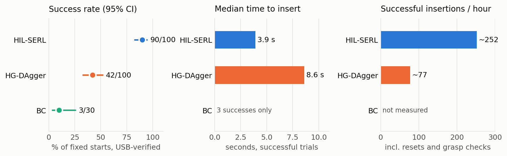
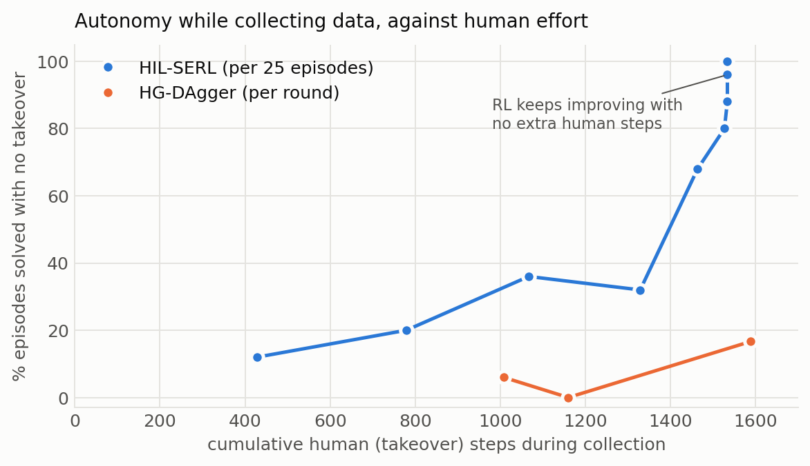
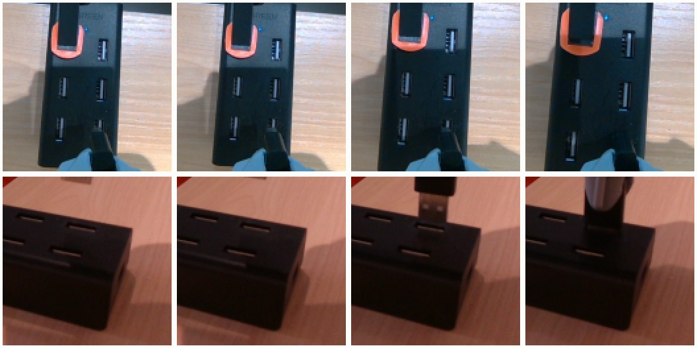
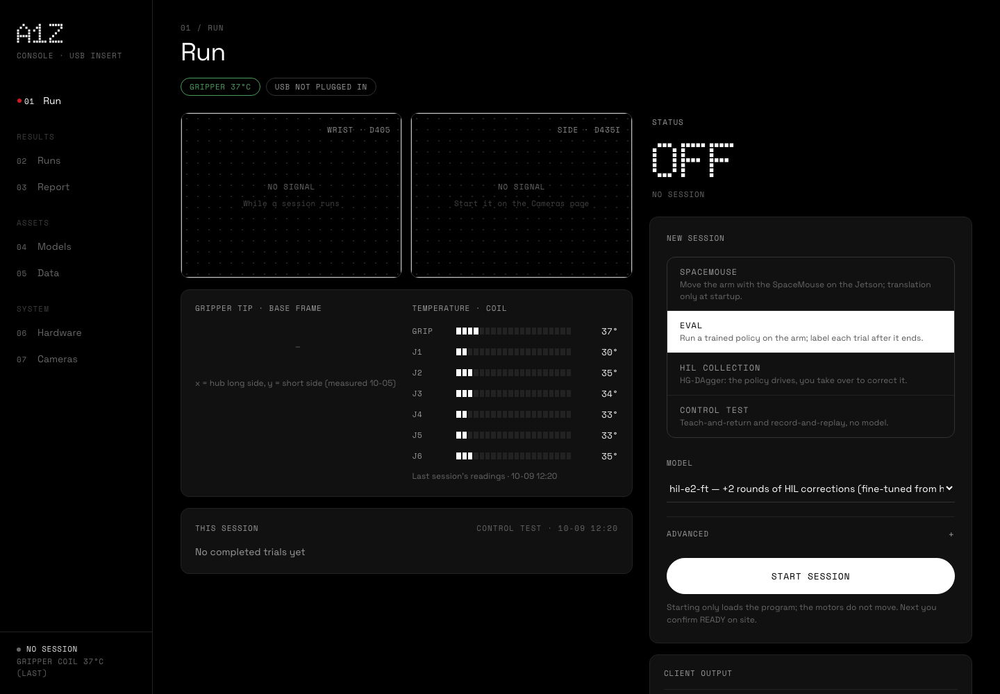
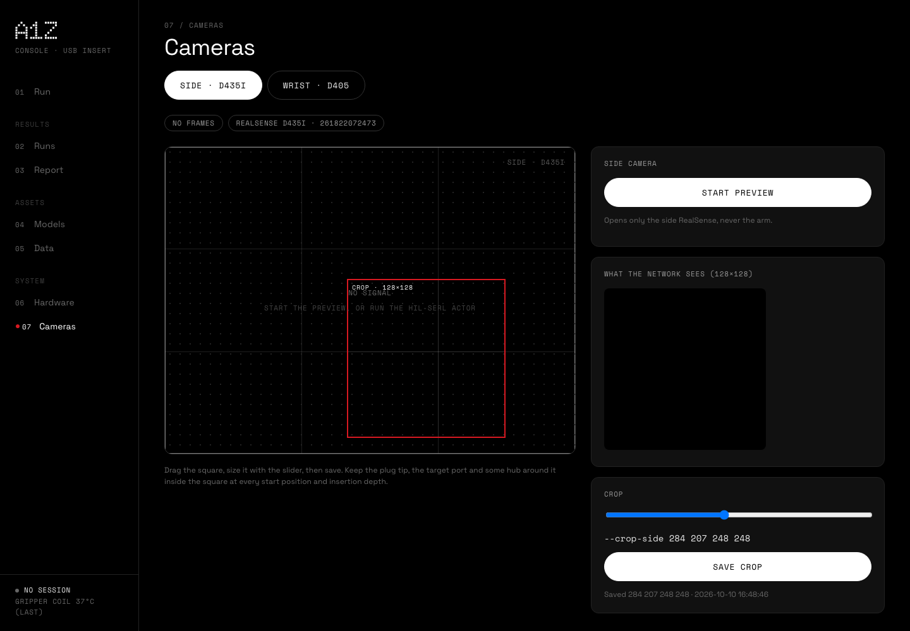
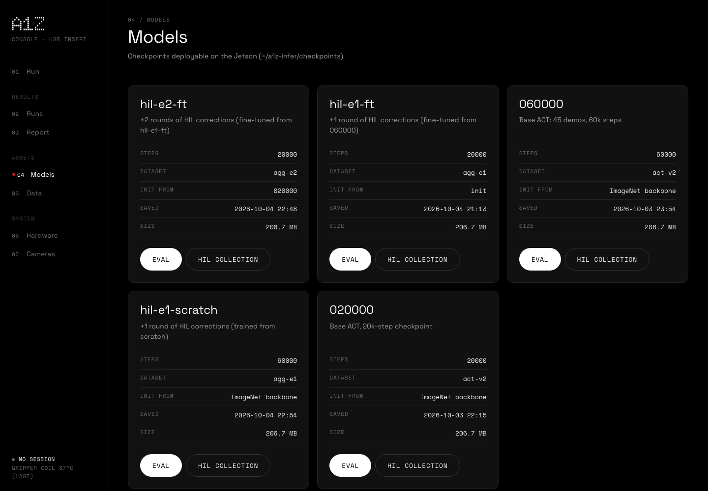
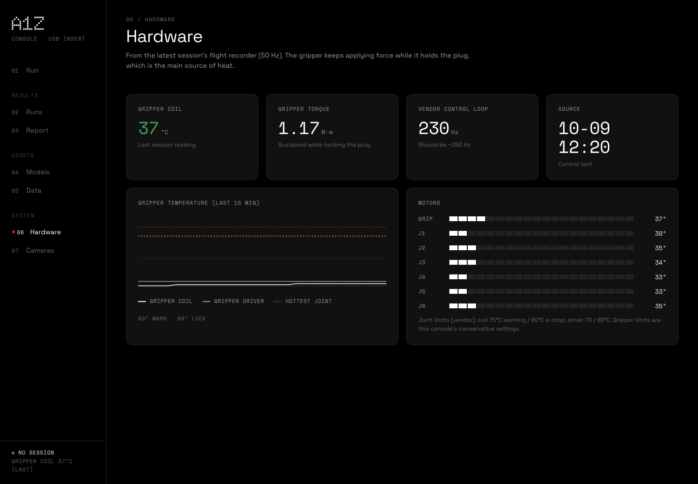
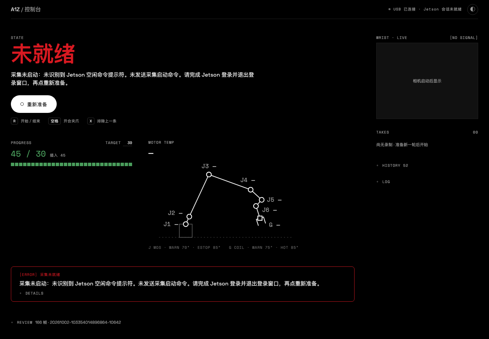

# A1Z: can RL make insertion more reliable than HG-DAgger?

Robot-learning experiments on a Galaxea A1Z arm. The task is to insert a USB-A plug into one fixed port of a USB hub.
The main question (Linear project P-END-200) is whether online RL with a human in the loop beats imitation learning
on **reliability and throughput**. Imitation learning here means ACT, either alone or with HG-DAgger corrections.

> Status (2026-10-11): experiments done; the full write-up is in progress and will replace parts of this page.
> Numbers below come from the run logs; the lab notebook has every failure and decision along the way.



| Method | Human data | Success (fixed starts) | 95% CI | Median time to insert | Successful insertions / h |
|---|---|---|---|---|---|
| **HIL-SERL** (SAC + RLPD, 204 training episodes) | 25 demos + 1,534 takeover steps | **90 / 100** | 82.6–94.5% | **3.9 s** | **~252** |
| HG-DAgger (ACT, 3 rounds, 86 episodes) | same 25 demos + 1,589 takeover steps | 42 / 100 | 32.8–51.8% | 8.6 s | ~77 |
| BC (ACT) | same 25 demos | 3 / 30 | 3.5–25.6% | ~6.5 s (3 successes) | — |

All three policies run in the same environment and are scored the same way:
- Same action space: 10 Hz end-effector xyz steps of up to 1.5 mm.
- Same starts: a random point within 10 mm of the port, 20–25 mm above the hub.
- Same contact controller and safety layer.
- Same evaluation: deterministic policy, no takeovers, and success means the USB device enumerates.

HIL-SERL and HG-DAgger were evaluated on the **same 100 start positions**. In the paired comparison, 52 starts were solved only by RL and 4 only by DAgger (McNemar p ≈ 1e-11). The two were given about the same amount of human takeover effort.



During data collection RL kept getting more autonomous after the operator stopped intervening. DAgger can only change between rounds, and only by imitating the operator.

## What the comparison does not control

- **Cameras.** RL sees the wrist and side cameras. ACT and DAgger see only the wrist camera, because the side camera was bumped before the baselines were run.
- **Setup.** RL was evaluated before the hub was moved and recalibrated. The baselines were evaluated after the hub was moved back by hand (within a few mm) and recalibrated.
- **Fixes to the baselines.** Each fix made DAgger stronger. All are documented in [`bc.py`](experiments/2026-10-09-hilserl/bc.py):
  - Operator idle frames are dropped.
  - The state is displacement from the start only.
  - Kinesthetic takeovers in contact get a "press" vertical label. Dragging records motion, not the downward push the hub blocks, so without this the model learned to stop pressing at the port.
- **One task, one station.** Generalisation is out of scope. A quick test with the hub shifted about 2 cm (recalibrated, not retrained) failed often; that test was confounded by the calibration offset.

## Setup

| | |
|---|---|
| Arm | Galaxea A1Z, joint PD on the vendor SDK, software Cartesian compliance near the hub (vertical push ≤ 11 N, lateral spring ≤ 4 N) |
| Compute | Jetson Orin (control at 30 Hz, policy at 10 Hz); learner on a rented RTX 4090 over gRPC |
| Cameras | RealSense D405 on the wrist; D435i at the side (exposure locked) |
| Gripper | 3D-printed fin-ray fingertips (the stock fingers let the plug slip) |
| Reward / referee | Side-camera classifier proposes success; USB enumeration of the exact port path confirms it |
| Takeover | Space bar floats the arm (gravity assist) and the operator drags it; space again hands back |

What the policies see (128×128 crops; top: wrist, bottom: side):



## Consoles

The A1Z Console (`experiments/2026-10-02/console/`) runs sessions, shows cameras and crops, lists models and monitors temperatures:

| | |
|---|---|
|  |  |
|  |  |

The earlier collection Studio (`Start Studio.command`, 2026-10-02) records kinesthetic demonstrations:



## Repository layout

| Path | What |
|---|---|
| [`experiments/2026-10-09-hilserl/`](experiments/2026-10-09-hilserl/) | HIL-SERL actor and learner, environment, reward classifier, side camera, ACT / HG-DAgger baselines (`bc.py`), tests, setup log |
| [`experiments/2026-10-02/`](experiments/2026-10-02/) | Robot process and SDK wrapper, kinematics, calibration, console, ACT pipeline, the first HG-DAgger and last-centimetre RL attempts |
| [`docs/`](docs/) | Figures, the experiment plan, the SpaceMouse note, and the 2026-10-02 capture README |

Run outputs (episodes, checkpoints) are kept on the Jetson and in `~/a1z-data`, not in git.

## Running it

Short version. The actor and the learner each print what they expect at every step.

```sh
# Mac: sync code to the Jetson
JETSON=jetson bash experiments/2026-10-09-hilserl/sync.sh jetson
# Jetson: demos, online training (learner on the GPU box), evaluation
bash ~/a1z-experiments/2026-10-09-hilserl/hilserl.sh demo  --n 25
bash ~/a1z-experiments/2026-10-09-hilserl/hilserl.sh train --demos runs/<demo-session> --clf classifier-side.pt
bash ~/a1z-experiments/2026-10-09-hilserl/hilserl.sh eval  --ckpt runs/<train-session>/actor-ep0200.pt --reward usb --n 100
# Baselines: train on a GPU, then collect corrections / evaluate on the Jetson
python bc.py train --demos runs/<demo-session> [--dagger runs/<dagger-session> ...] --out runs/act-<name>
bash ~/a1z-experiments/2026-10-09-hilserl/hilserl.sh dagger --ckpt runs/act-<name>/act-last.pt --views wrist --episodes 50
```

The offline tests (`python test_hilserl.py`) use a fake arm and do not touch hardware.

## Safety notes

- The A1Z has no brakes. Never cut power with the arm in the air: put it on its support before the second `q q`.
- The actor pauses before an episode on joint temperature (78 °C) and when free disk space is low (< 1.5 GB). A full disk once crashed a run and dropped the arm.
