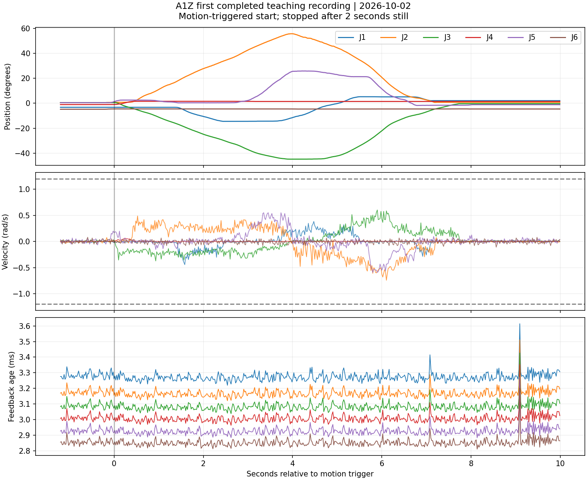

# 首条完整拖拽轨迹检查 — 2026-10-02

结果：基础数据检查通过。运动触发开始，连续静止两秒后正常结束；停用指令发送无异常。这不是自动回放或策略训练成功。

- 保存 551 帧，覆盖 11.19 秒（含触发前段）。
- 实际采样 49.2 Hz；最大采样间隔 24.39 ms。
- 六关节反馈最大年龄 3.61 ms，未触发 100 ms 超时。
- 最大反馈角速度 0.743 rad/s；时间严格递增，位置与速度均为有限数，电机状态正常。
- 各关节运动范围（度）：[19.71, 55.1, 45.27, 2.6, 27.61, 0.33]。
- 各关节相邻样本最大位置变化（度）：[0.37, 0.7, 0.61, 0.2, 0.76, 0.07]。曲线检查不等于已证明回放安全。

数据为六关节轨迹及控制记录，尚无同步相机和夹爪数据，尚未验证回放。不直接标记成 HIL-SERL 训练样本。Jetson 系统时间未校准，采用单调时间检查时序。
